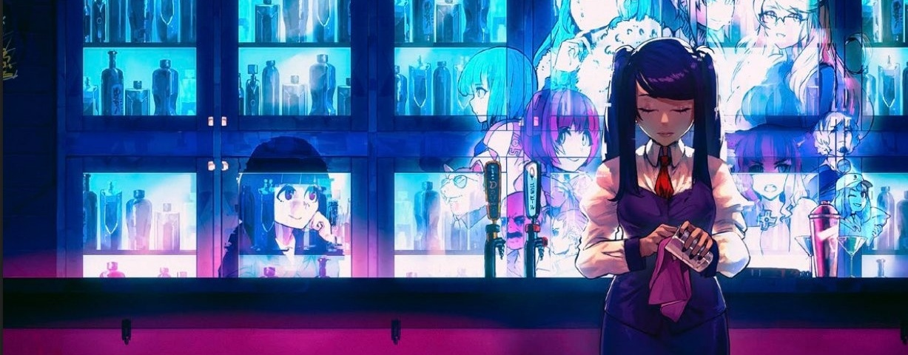
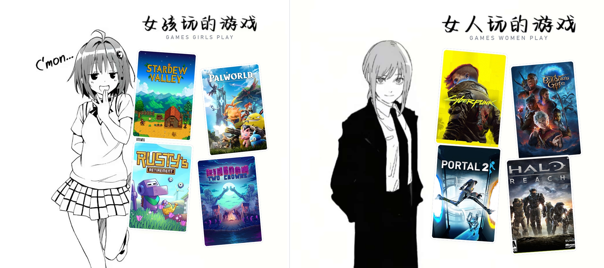

  

<h3 align="center"><em>“Compiling codes, changing lives.”</em></h3>

### Hi there, I'm Reese 👋

🎓 **M.Sc. in Computer Systems and Cybersecurity** @ Chalmers University of Technology  
📍 Based in Gothenburg, Sweden 🇸🇪  

Working on **AI infrastructure** and **distributed systems**. I like the engineering problems where measurement disagrees with theory, whether that is a GPU memory limit or a network partition.

#### 🛠️ Tech Stack

#### 🔭 Currently Working on
- **Napkin Math for LLM Fine-tuning**: Analytical models for GPU memory, compute and communication limits in LLM fine-tuning, validated against measured runs of 1B to 7B models on Chalmers' HPC cluster. *(report due October 2026)*
- **[Distributed KV Store](https://github.com/potato1778/mit-6824-go)**: A fault-tolerant key-value store built on the **Raft** consensus algorithm in Go, featuring leader election, log replication, persistence and chaos testing under network partitions.

#### 🧪 Selected Work
- **[shield-mimic-extension](https://github.com/potato1778/shield-mimic-extension)**: Extended the Shield framework in Java for privacy-preserving stream processing over MIMIC-IV ICU waveforms, raising the privacy score from 0.788 to 0.972 using NSGA-II multi-objective optimization.
- **[TaskbarExtras](https://github.com/potato1778/TaskbarExtras)**: Restoring the Windows 10 taskbar context menu on Windows 11 using documented Win32 APIs and WPF, without injecting into `explorer.exe`.
- **[mit-6824-go](https://github.com/potato1778/mit-6824-go)**: Fault-tolerant distributed key-value storage and MapReduce implementation in Go, passing randomized testing for crash recovery and network isolation.
- **Retrieval-Augmented QA**: An end-to-end question-answering system with local embeddings, FAISS vector retrieval and grounded LLM generation.

#### 🎮 Off Duty & Gaming Quests

  

> *“两种游戏我都很爱~ (I love both worlds dearly!)”*  
> From chill, cozy idle farming in *Stardew Valley* & *Rusty's Retirement*, to diving into Night City chaos in *Cyberpunk 2077* and clutching with Noble Team in *Halo: Reach* 🥔✨

*(Systems habits never die: 1800+ hrs of Bongo Cat on the desktop, always tuning Lossless Scaling.)*

  
  &nbsp;&nbsp;
  
  &nbsp;&nbsp;
  

📫 **Drop a message**: ruizeliu.heu@gmail.com

---

<picture>
  <source media="(prefers-color-scheme: dark)" srcset="https://raw.githubusercontent.com/potato1778/potato1778/output/github-snake-dark.svg" />
  <source media="(prefers-color-scheme: light)" srcset="https://raw.githubusercontent.com/potato1778/potato1778/output/github-snake.svg" />
  
</picture>
